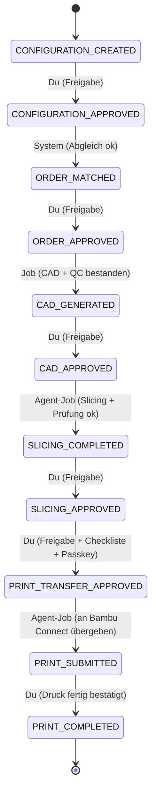

# Phase 2 · Freigabe-Workflow

Stand: 2026-10-27 · Status: **Entwurf, wartet auf Freigabe**

## 1. Grundprinzip

- Ein **Workflow** = eine Bestellposition (ein Anhänger-Design, Menge N). Vor der Bestellung existiert er bereits mit der Konfiguration, aber ohne Bestellung.
- Ein Workflow hat genau einen **Hauptstatus** (`state`) und optional eine **Sperre** (`block`). Solange eine Sperre gesetzt ist, ist kein Vorwärts-Übergang möglich.
- Übergänge sind nur in `packages/workflow` definiert **und** werden zusätzlich von einem Datenbank-Trigger erzwungen. Selbst ein fehlerhafter Code-Pfad oder ein manueller SQL-Befehl kann keine Stufe überspringen.

## 2. Zustände und Übergänge



| Von | Nach | Auslöser | Bedingung |
|---|---|---|---|
| CONFIGURATION_CREATED | CONFIGURATION_APPROVED | **Freigabe** | Validierung bestanden, Vorschau vorhanden |
| CONFIGURATION_APPROVED | ORDER_MATCHED | System | Bezahlte Etsy-Bestellung, Code eindeutig, Menge/Preis/Variante passen |
| ORDER_MATCHED | ORDER_APPROVED | **Freigabe** | – |
| ORDER_APPROVED | CAD_GENERATED | Job `CAD_GENERATE` | Alle QC-Prüfungen ohne `FAIL` |
| CAD_GENERATED | CAD_APPROVED | **Freigabe** | Freigabe referenziert Hash von STL + SCAD + Bericht |
| CAD_APPROVED | SLICING_COMPLETED | Agent-Job `SLICE` | STL-Hash = freigegebener Hash; Slicer ohne Fehler; Profile = Soll |
| SLICING_COMPLETED | SLICING_APPROVED | **Freigabe** | Freigabe referenziert Hash der .gcode.3mf |
| SLICING_APPROVED | PRINT_TRANSFER_APPROVED | **Freigabe** | Checkliste: Düse montiert, Filament in AMS-Slot X, Druckbett frei; Passkey-Bestätigung |
| PRINT_TRANSFER_APPROVED | PRINT_SUBMITTED | Agent-Job `HANDOFF` | 3MF-Hash = freigegebener Hash; Agent nicht im Trockenlauf |
| PRINT_SUBMITTED | PRINT_COMPLETED | **Bestätigung** | Du bestätigst Druckergebnis (optional Foto) |

Hinweis zu `PRINT_SUBMITTED`: Mit Bambu Connect heißt das „Datei an Bambu Connect übergeben“. Der tatsächliche Druckstart ist dein Klick in Bambu Connect. Das System behauptet nie, der Druck laufe, solange es das nicht weiß.

## 3. Sperren (`block`)

| Sperre | Ursache | Aufheben durch |
|---|---|---|
| `FAILED` | Job-Fehler, QC-`FAIL`, Timeout, Absturz während eines Jobs | „Erneut ausführen“ (neuer Job, gleicher Zustand) oder Abbrechen |
| `NEEDS_CLARIFICATION` | Code fehlt/ungültig/doppelt, nicht bezahlt, Preis/Menge/Variante weicht ab | Manuelle Zuordnung oder Abbrechen |
| `REJECTED` | Du hast abgelehnt (mit Pflicht-Begründung) | Erneut ausführen · Konfiguration ändern · Abbrechen |
| `ON_HOLD` | Du pausierst manuell | Fortsetzen |

Endzustände außerhalb der Kette: `CANCELLED` (manuell oder Etsy `order.canceled`). Ein abgebrochener Workflow kann nicht wieder aufleben.

## 4. Regeln (Umsetzung der Pflichtanforderungen)

| Anforderung | Umsetzung |
|---|---|
| Keine übersprungene Stufe | Übergangstabelle in Code **und** DB-Trigger; nur Nachfolger-Zustand erlaubt |
| Freigabe nur authentifiziert | Freigabe-Endpunkt verlangt Admin-Sitzung + CSRF; Druckübertragung zusätzlich Passkey-Step-up |
| Freigabe gilt für genau diese Dateien | `approvals.target_hash` = SHA-256 über alle relevanten Artefakt-Hashes; nachgelagerte Jobs prüfen den Hash vor Ausführung |
| Fehlgeschlagene Prüfung blockiert | QC-`FAIL` ⇒ kein Übergang, Sperre `FAILED` |
| Ablehnung pausiert | Sperre `REJECTED` |
| Konfigurationsänderung entwertet Freigaben | Neue Konfigurationsversion ⇒ alle Freigaben dieses Workflows werden als ungültig markiert (`approval_invalidations`), Zustand zurück auf `CONFIGURATION_CREATED`, Bestellzuordnung wird neu geprüft |
| Keine doppelten Aufträge | Eindeutige Schlüssel auf Etsy-Position, Webhook-ID, Job-Idempotenzschlüssel, E-Mail-Schlüssel, Handoff je Freigabe |
| Neustart umgeht nichts | Zustand nur in DB; laufende Jobs mit abgelaufener Lease ⇒ `FAILED`, nie „erfolgreich“ |
| Technischer Fehler ≠ Freigabe | Freigaben entstehen ausschließlich durch die Freigabe-Aktion eines Menschen (bzw. später eine explizit aktivierte Richtlinie); Fehlerpfade schreiben nie in `approvals` |
| Automatik standardmäßig aus | Tabelle `automation_policies`, alle `enabled = false`; in v1 ignoriert der Code die Tabelle vollständig; DB verbietet Automatik für `PRINT_TRANSFER_APPROVED` und `PRINT_COMPLETED` |

## 5. Atomarer Ablauf einer Freigabe

```
BEGIN;
  SELECT * FROM workflows WHERE id = $1 FOR UPDATE;           -- Sperre gegen Doppelklick
  prüfen: state = erwarteter Zustand, block IS NULL, row_version = $client_version
  prüfen: target_hash = aktueller Hash der Artefakte
  INSERT INTO approvals (...) RETURNING id;
  UPDATE workflows SET state = $next, row_version = row_version + 1, last_approval_id = $approval;
  INSERT INTO state_transitions (...);                        -- Historie
  INSERT INTO jobs (...) ON CONFLICT (idempotency_key) DO NOTHING;  -- Folge-Job, falls nötig
COMMIT;
```

Schlägt irgendein Schritt fehl, wird alles zurückgerollt; es gibt keinen halben Zustand.

## 6. Kontrolloberfläche (pro Stufe)

Jede Detailseite zeigt: Status + Sperre · Konfigurationscode + Version · Etsy-Bestellung/Position · Vorschau (3D-Viewer, Slicing-Bilder) · Dateien mit Hash und Download · Prüfergebnisse (PASS/WARN/FAIL mit Messwert und Grenzwert) · Warnungen/Fehler · Buttons **Freigeben / Ablehnen / Erneut ausführen / Pausieren / Abbrechen** (nur die im Zustand erlaubten) · Historie aller Übergänge und Entscheidungen.

Übersicht (Dashboard) mit Filtern: nicht bestellt · Zuordnung nötig · CAD wartet · gesliced · Druck wartet · gedruckt · Fehler.

## 7. Spätere Automatisierung (nicht v1)

Pro Übergang kann eine Richtlinie aktiviert werden, z. B. „`CAD_GENERATED → CAD_APPROVED` automatisch, wenn alle Prüfungen PASS und keine WARN, Schrift + Form bereits ≥ 20× manuell freigegeben“. Automatische Freigaben werden als `approvals` mit `actor_type = 'POLICY'` protokolliert. Aktivierung nur mit Passkey, im Auditlog. Die Druckübertragung bleibt wegen Bambu Connect ohnehin manuell.
